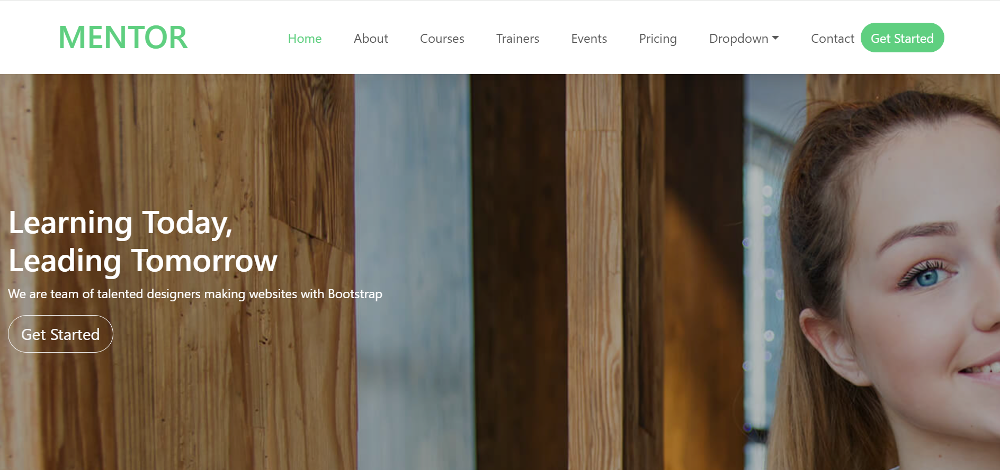
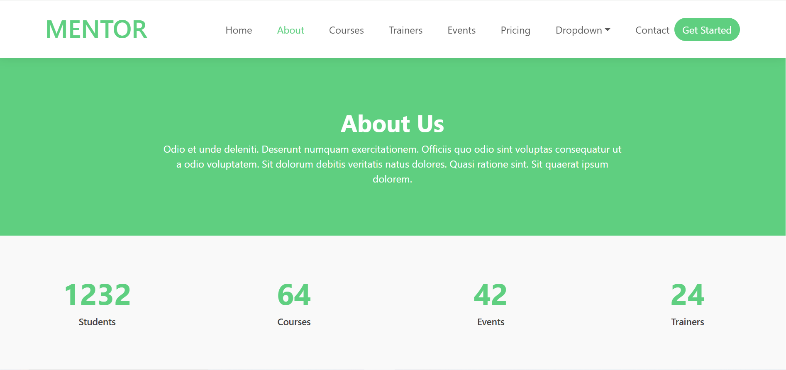
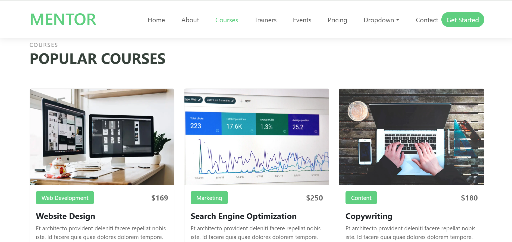
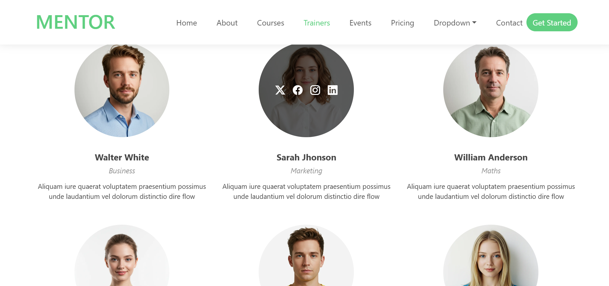
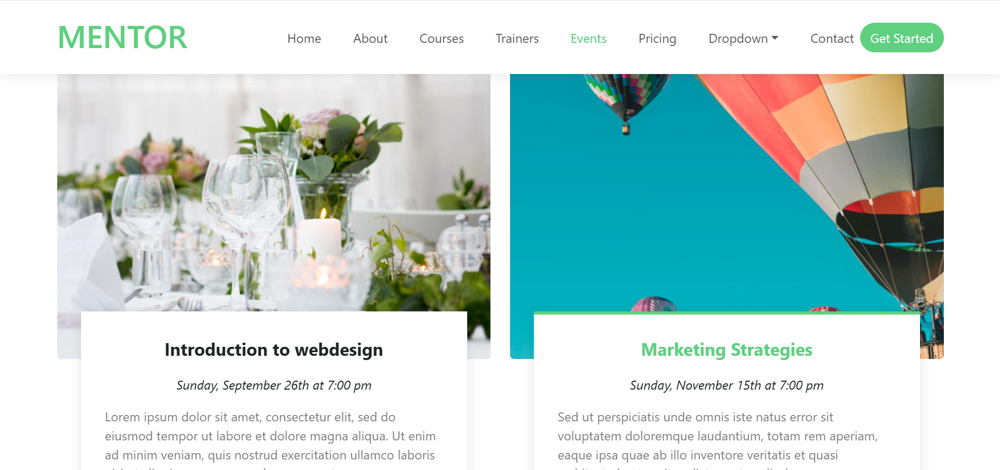
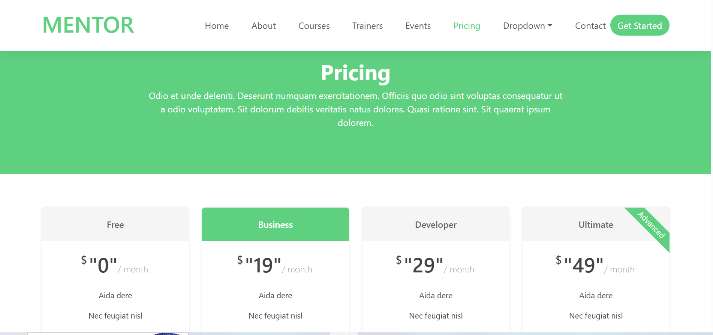
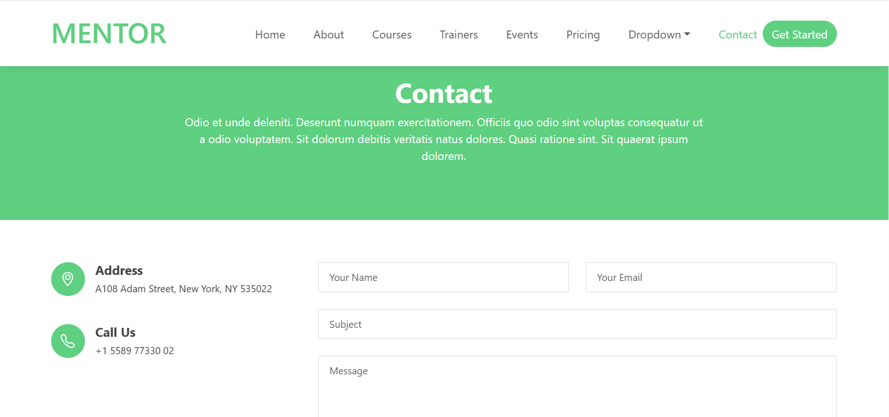

# Bootstrap Multi-Page Website

A responsive multi-page website built using **HTML, CSS, JavaScript, and Bootstrap**.
The project contains multiple pages with a clean and responsive layout designed for different screen sizes.

## 🚀 Live Demo

[View Live Demo](https://bootstrap-project-mobile-friendly.netlify.app/)

## 📸 Screenshots

### Home Page



### About Page



### Courses Page



### Trainers Page



### Events Page



### Pricing Page



### Contact Page



## ✨ Features

* Responsive multi-page website
* Bootstrap-based responsive layout
* Home page
* About page
* Courses page
* Trainers page
* Events page
* Pricing page
* Contact page
* Responsive navigation bar
* Responsive sections and content
* Bootstrap grid system
* Mobile-friendly design
* Clean and structured UI
* Cross-browser compatible layout

## 📄 Pages

The project includes the following pages:

* **Home** – Main landing page
* **About** – Information about the website/institution
* **Courses** – Available courses and programs
* **Trainers** – Trainer/instructor information
* **Events** – Upcoming and previous events
* **Pricing** – Prices of courses 
* **Contact** – To contact us

## 🛠️ Technologies Used

* HTML5
* CSS3
* JavaScript
* Bootstrap 5
* Bootstrap Icons
* AOS (Animate On Scroll), if used in the project

## 📁 Project Structure

```text
bootstrap-project/
│
├── index.html
├── about.html
├── courses.html
├── trainers.html
├── events.html
├── pricing.html
├── contact.html
│
├─── css/
│     └── style.css
│  
│├─── img/
│      └── ...
│     
│├── screenshots/
│   ├── home.png
│   ├── about.png
│   ├── courses.png
│   ├── trainers.png
│   └── events.png
│   └── pricing.png
│   └── contact.png
│
└── README.md
```

## 📱 Responsive Design

The website is designed to work across different screen sizes:

* Desktop
* Laptop
* Tablet
* Mobile

Bootstrap's responsive grid system and utility classes are used to create the responsive layout.

## 🎨 Bootstrap Concepts Used

This project demonstrates practical usage of Bootstrap features such as:

* Container
* Row & Columns
* Responsive Grid
* Flexbox utilities
* Spacing utilities
* Typography utilities
* Responsive images
* Navbar
* Dropdowns
* Cards
* Buttons
* Forms
* Responsive breakpoints

## ⚙️ How to Run Locally

### 1. Clone the repository

```bash
git clone 
```

### 2. Open the project

```bash
cd bootstrap-project
```

### 3. Run the project

Since this is a static website, you can open `index.html` directly in your browser.

For a better development experience, you can use **VS Code Live Server**.

## 🌐 Deployment

This project can be deployed easily using **Netlify**.

## 👨‍💻 Author

**Sourabh**

GitHub: [Your GitHub Profile](Sourabh359)
